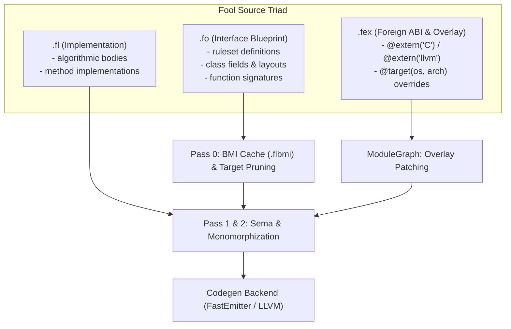

# The Fool Systems Programming Language (`foolc`)

> **Fool** is a modern systems programming language combining the raw control of C++, the memory ergonomics and transitive immutability of Rust, and a clean compile-time triad architecture.

---

## Table of Contents

- [Key Language Invariants](#key-language-invariants)
  - [1. File Triad Architecture (.fo / .fl / .fex)](#1-file-triad-architecture-fo--fl--fex)
  - [2. Mutability & Reference Model](#2-mutability--reference-model)
  - [3. Explicit Receivers](#3-explicit-receivers)
  - [4. Middle & Trailing Parameter Defaults](#4-middle--trailing-parameter-defaults)
  - [5. Nominal Capability Rulesets & Blueprints](#5-nominal-capability-rulesets--blueprints)
  - [6. Directive-Only Attribute System (@)](#6-directive-only-attribute-system-)
- [Repository Structure](#repository-structure)
- [The `foolc` Compiler Architecture](#the-foolc-compiler-architecture)
- [Standard Library (`stdlib/`)](#standard-library-stdlib)
- [Examples & Test Suite](#examples--test-suite)
- [IDE Extensions (VS Code, Cursor, CLion, JetBrains)](#ide-extensions)
  - [VS Code / Cursor](#vs-code--cursor)
  - [CLion & JetBrains IDEs](#clion--jetbrains-ides)
- [Building the Compiler](#building-the-compiler)
- [License](#license)

---

## Key Language Invariants

### 1. File Triad Architecture (`.fo` / `.fl` / `.fex`)

Fool replaces legacy C/C++ header files and monolithic source translation units with a strict, compiler-enforced triad:

| Extension | Role | Contents | Invariants |
| :--- | :--- | :--- | :--- |
| **`.fo`** | **Interface Blueprint** | Declarations, nominal `ruleset` capability bounds, `class` memory layouts, `blueprint` templates, and public function signatures. | **Zero executable bodies**. Cached as Binary Module Interfaces (`.flbmi`, see below). |
| **`.fl`** | **Implementation Unit** | Pure Fool algorithmic logic, method bodies, and state machine step transitions. | Declares `module <name>;`. **Never self-imports its companion `.fo`**. External `#import` allowed. |
| **`.fex`** | **External / Platform Overlay** | Foreign ABI bindings (`@extern("C")`, `@extern("llvm")`), kernel syscalls, and target-specific overrides. | Gated by `@target(os = "...", arch = "...")`. Merged in Pass 0. |



---

### 2. Mutability & Reference Model

Fool eliminates the verbose `mut` keyword in favor of clean, predictable mutability defaults:

- **No `mut` keyword exists in Fool**:
- **Mutable by Default**:
  - **Variables**: `counter = 0;` (or `var count: i32 = 0;`). In-place mutation is valid.
  - **References**: `&T` (e.g. `fn write(buffer: &Span<u8>)`).
  - **Pointers**: `*T` (e.g. `data: *u8`).
  - **Receivers**: `this &self` (e.g. `fn append(this &self, byte: u8) -> bool`).
- **Rust-like Strict Transitive Immutability with `const`**:
  - **Immutable Bindings**: `const val = 42;` (or `const val: i32 = 42;`). Reassignment is a compile-time error.
  - **Immutable References**: `const& T` (e.g. `fn read(data: const& Span<u8>)`).
  - **Immutable Pointers**: `const* T` (e.g. `bytes: const* u8`).
  - **Immutable Receivers**: `this const& self` (e.g. `fn len(this const& self) -> usize`).
  - *Semantics*: Complete transitive read-only protection. Calling `this &self` methods on a `const&` instance is prohibited.
- **Compile-Time Constants with `constx`**:
  - C++ `constexpr` / Rust `const` equivalent: `constx BUFFER_CAPACITY: usize = 4096;`. Evaluated strictly at compile time.

---

### 2b. Scopes & Shadowing

Fool follows C++ block scoping. A `{ ... }` block, an `if`/`while` body, a `for` loop (loop variable plus body) and every
branch of a compile-time `@if` open a new scope. A name declared in a nested scope **shadows** the same name from an
enclosing scope until the end of its block; afterwards the outer name is visible again and was never modified:

```fool
fn run(count: i32) -> i32 {
    var total = 1;
    {
        var total = 2;        // shadows the outer `total`
        total = total + 1;    // changes the inner variable only
    }
    if (count > 0) {
        var count = 5;        // shadows the parameter inside this block
        total = total + count;
    }
    return total;             // the outer `total`
}
```

- Redeclaring a name **in the same scope** is an error, including a parameter at the top level of the function body
  (`redefinition of 'x' in this scope`), exactly as in C++.
- Shadowing also applies to `constx`: a local that shadows a constant hides its compile-time value inside the block.
- One deliberate difference from C++: a declaration's initializer is evaluated *before* the new name enters scope, so
  `var total = total + 1;` in a nested block reads the outer `total` instead of the variable being declared.
- `foolc --warn-shadow` reports every declaration that hides a variable of an enclosing scope or a global variable
  (with a note at the hidden declaration), like C++ `-Wshadow`; `-Werror` turns warnings into a failing exit code.
  Sibling scopes reusing a name do not count as shadowing. Test files can assert warnings with `// expect-warning: <text>`.
- The checker, the const evaluator and the borrow checker all use the same scoping, so a shadowing variable is never
  confused with the one it hides.

---

### 2c. Casts

`expr as T` stays as the unchecked, C-style conversion (needed for FFI and low-level code; it wraps instead of failing).
Everything else is spelled as a named cast, `@name<T>(expr)`, and is validated by the checker:

| Cast | Allowed conversions | Rejected with an error |
| :--- | :--- | :--- |
| `@static_cast<T>(x)` | integer / float / `bool`-to-integer conversions, `*void` ⇄ `*U`, `&T` → `*T`, adding `const` | pointer ⇄ integer, unrelated pointee types, removing `const`, `*T` → `&T`, anything → `bool` (compare explicitly), a **constant** that does not fit the target |
| `@dynamic_cast<*T>(x)` | checked downcast of a ruleset view (`&Shape` / `*Shape`) to a class or struct pointer; the result is `null` when the dynamic type is not `T` | non-pointer target, primitive / ruleset / enum target, operand that is not a ruleset view, removing `const` |
| `@reinterpret_cast<T>(x)` | pointer ⇄ pointer, pointer ⇄ **pointer-sized** integer (`usize` / `isize`, width taken from `--target`), `&T`/`*T` → `*U` | removing `const`, producing a reference, any other pair (it points you to `@static_cast` or `@bit_cast`) |
| `@bit_cast<T>(x)` | reinterpret the bytes of a value as another type of **exactly the same size** (`f32` ⇄ `u32`, a struct ⇄ an integer, ...) | different sizes (both are printed), references, types of unknown size |

```fool
var bits  = @bit_cast<u32>(ratio);            // f32 -> u32, same 4 bytes
var small = @static_cast<u8>(300);            // error: constant 300 does not fit in 'u8'
var addr  = @reinterpret_cast<usize>(raw);    // pointer -> pointer-sized integer
var sq    = @dynamic_cast<*Square>(shape);    // null unless `shape` really is a Square
```

- Sizes follow natural C layout (fields in declaration order, padded to their alignment) and use the target's pointer width.
- `@static_cast` and `@bit_cast` between scalars (and `as`) are folded inside `constx` initializers, e.g.
  `constx ONE_BITS: u32 = @bit_cast<u32>(@static_cast<f32>(1.0));`. Pointer casts are never constant.
- Type information is inferred conservatively (literals adapt to the type they are cast through; generics and values
  of unknown type skip the check instead of guessing).
- `@dynamic_cast` is only type-checked today: classes do not declare which rulesets they implement and there is no
  code generator yet, so conformance and the runtime type test are future work.

---

### 3. Explicit Receivers

Methods in Fool do not rely on implicit, hidden `this` pointers. The receiver is explicitly declared as the first parameter:

```fool
// 1. Immutable Borrow (Read-only query)
fn ByteBuffer::length(this const& self) -> usize {
    return self.len;
}

// 2. Mutable Borrow (In-place mutation, no 'mut' keyword)
fn ByteBuffer::append(this &self, byte: u8) -> bool {
    self.len = self.len + 1;
    return true;
}

// 3. Consuming Receiver (Destructive move / ownership transfer)
fn ByteBuffer::destroy(this self) {
    // self is consumed and invalidated at the caller
    return;
}
```

---

### 4. Middle & Trailing Parameter Defaults

Fool supports default expressions in **any** parameter slot, including middle positions:

```fool
// Signature in .fo:
async fn render_box(x: f32, y: f32, scale: f32 = 1.0, width: f32, height: f32) -> i32;

// Call sites:
render_box(10.0, 20.0, 1.0, 100.0, 200.0);       // Positional
render_box(10.0, 20.0, width: 100.0, height: 200.0); // Middle default preserved with named args
```

---

### 5. Nominal Capability Rulesets & Blueprints

Fool deliberately rejects class inheritance in favor of pure data structures and nominal capability bounds (`ruleset`):

```fool
// ruleset definition (C++ concept / Rust trait equivalent)
ruleset Equatable<T> {
    fn equals(this const& self, other: const& T) -> bool;
}

ruleset Printable<T: Equatable> {
    fn to_string(this const& self) -> StringView;
}

// Monomorphized compile-time template
blueprint VectorMath<SIMD: bool = false> {
    fn dot_product(a: const* f32, b: const* f32, len: usize) -> f32;
}
```

---

### 6. Directive-Only Attribute System (`@`)

`@` is strictly a compile-time attribute/directive marker, never a unary or binary expression operator:

```fool
@target(os = "windows", arch = "x86_64")
@extern("C", link_name = "VirtualAlloc")
fn win32_virtual_alloc(addr: *void, size: usize, alloc_type: u32, protect: u32) -> *void;
```

---

### 7. Parameterized Module Imports & Conditional Directives (`@if def(...)`)

In C/C++, libraries frequently depend on `#define CONFIG_FLAG` macros placed before `#include` to configure dependencies from the call site. Fool replaces this with hygienic **Module Templates** and **Import Templates**:

**Module Definition (with default values):**
```fool
module name1<ASIO_IOURING_ON = 1, INIT = 0>; // declared with default values

@if def(ASIO_IOURING_ON) && (ASIO_IOURING_ON == 1)
fn func1() {
    // Compiled when ASIO_IOURING_ON is active and equal to 1
}
```

**Consumer Import Sites:**
```fool
// 1. With explicit compile-time overrides:
#import name1<ASIO_IOURING_ON = 1>;

// 2. Or using the module's default values:
#import name1;
```

Dependent modules cleanly supply configuration values down to dependencies without global preprocessor macro leakage.

---

## Repository Structure

```
fool-origin/
├── .agent/                    # Antigravity rules and skills
│   ├── rules/                 # fool-language-rules.md, foolc-compiler-rules.md
│   └── skills/                # fool-authoring, foolc-compiler-dev
├── editors/
│   └── vscode/                # VS Code / Cursor extension source & packaging
│       ├── package.json
│       ├── language-configuration.json
│       ├── syntaxes/fool.tmLanguage.json
│       ├── snippets/fool.json
│       ├── build_vsix.py      # Standalone VSIX packager
│       └── fool-vscode-0.1.0.vsix
├── examples/                  # Fool Language Test Suite
│   ├── 01_basics.fo / .fl
│   ├── 02_receivers_and_mutability.fo / .fl
│   ├── 03_middle_defaults.fo / .fl
│   ├── 04_rulesets_and_blueprints.fo / .fl
│   ├── 05_target_pruning.fex
│   └── 06_full_program.fo / .fl
├── src/                       # foolc C++23 Compiler Implementation
│   ├── Common/                # Arena allocator, StringInterner, SourceLocation
│   ├── Lexer/                 # Zero-copy tokenizer
│   ├── AST/                   # Arena-allocated AST nodes & statements
│   ├── Parser/                # Pratt & recursive descent parser with error recovery
│   ├── Sema/                  # Pass 0 pruning + const-eval, Pass 1 module graph, Pass 2 checker, borrow checker
│   ├── Module/                # `.flbmi` cache: SHA-256, binary parse-tree codec, on-disk cache manager
│   └── main.cpp               # Driver CLI (file / project / expect-error test modes)
├── stdlib/                    # Standard Library (52 files across 7 subsystems)
│   ├── core/                  # memory, span, atomic, rulesets
│   ├── io/                    # file I/O, platform syscall bindings
│   ├── sync/                  # mutex, channel, platform futex/wait
│   ├── async/                 # event loops (epoll, kqueue, iocp, wasm), futures
│   ├── net/                   # tcp sockets
│   ├── math/                  # scalar and SIMD vector math
│   └── sys/                   # process and environment
├── tests/                     # positive/negative/borrow/warn regression tests, project and cache fixtures
├── CMakeLists.txt             # Modern CMake build configuration (Ninja + C++23 modules)
├── CMakePresets.json          # `cmake --preset default`
└── fool-vscode-0.1.0.vsix     # Packaged VSIX ready for installation
```

---

## The `foolc` Compiler Architecture

The `foolc` compiler is written in modern C++23 using C++ modules (`.ixx` interface partitions, `.cpp` implementation units) and enforces strict architectural invariants:

1. **Strict Class Layout Invariant**:
   Every class and struct declaration in `src/` follows the 3-section ordering:
   - **Member variables FIRST on top** with the `m_` prefix.
   - **Constructors and Destructors in the MIDDLE**.
   - **Member functions LAST at the bottom**.

2. **Linear Bump Allocation (`fool::Arena`)**:
   AST nodes, statements, and semantic symbols are bump-allocated in a continuous memory arena, ensuring cache locality and zero individual heap allocation overhead.

3. **String Interning (`fool::StringInterner`)**:
   Identifiers, tokens, and symbols are interned into compact 32-bit `SymbolID` values for fast $O(1)$ equality comparisons.

4. **Multi-Pass Compilation Pipeline**:
   - **Pass 0 (Target Pruning)**: Evaluates `@target(os, arch, pointer_width)` attributes (several `@target`s are OR'd, keys inside one are AND'd; `os = "posix"` matches linux/darwin/BSDs), top-level and statement-level `@if` conditions, module parameters and `constx` values. Platform files are selected by stem suffix (`_linux`, `_posix`, `_windows`, `_wasm`, `_wasi`, ...). The AST is never mutated, so one tree can be checked under several instantiations.
   - **Pass 1 (Module Graph)**: Indexes files by their declared module name, resolves `#import`s (including template arguments), reports unresolved/self/cyclic imports and produces a topological compilation order.
   - **Pass 2 (Type Checking)**: Declaration consistency between `.fo` and `.fl`, duplicate fields/variants/definitions, `const`/`const&`/`const*` immutability, `this` receiver rules, use-after-move for consuming receivers, named/default argument binding, struct-literal field checks, `constx` evaluation with integer range and overflow checks, return-path analysis, `break`/`continue` placement.

### Implementation status

| Area | Status |
| :--- | :--- |
| Lexer, Parser (Pratt, speculative generics, error recovery) | Implemented |
| Pass 0 pruning, `@if def(...)`, const evaluation | Implemented |
| Pass 1 module graph, import templates, cycle detection | Implemented |
| Pass 2 checks listed above, named casts | Implemented (name/type resolution is structural, not a full type system) |
| Expression type inference, generics instantiation | Not implemented |
| Opt-in borrow checker (`--check-borrow`) | Implemented (intra-procedural, see below) |
| BMI cache (`.flbmi`): SHA-256 keyed parse-tree cache (`--cache`) | Implemented (see below) |
| Bound calls: canonical argument slots, defaults filled (`--dump-calls`) | Implemented |
| HIR/MIR, code generation | **Planned** |

> Import-template instantiations are checked as separate runs of the importing module's dependency, but cross-module lookups currently use the default instantiation of the imported module.

---


## Standard Library (`stdlib/`)

The standard library provides foundational primitives implemented across the `.fo`, `.fl`, and `.fex` triad:

- **`std::core`**: Memory management, bump allocation, `Span<T>`, `Atomic<T>`, and fundamental capability rulesets (`Equatable`, `Comparable`, `Hashable`, `Clone`).
- **`std::io`**: High-performance buffered I/O with platform-specific syscall overlays (`posix`, `win32`, `wasi`).
- **`std::sync`**: Cross-platform lightweight `Mutex<T>` (using Futex on Linux, `WaitOnAddress` on Windows, `ulock` on macOS) and thread-safe MPMC `Channel<T>`.
- **`std::async`**: Async runtimes and event loops optimized for `epoll` (Linux), `iocp` (Windows), `kqueue` (macOS), and WebAssembly.
- **`std::net`**: Non-blocking TCP sockets.
- **`std::math`**: SIMD-accelerated linear algebra blueprints.
- **`std::sys`**: Process control and OS-level metadata.

---

## Examples & Test Suite

The `examples/` directory contains verified test cases:

| Example | Tested Capabilities |
| :--- | :--- |
| [`01_basics`](examples/01_basics.fo) | `constx`, `const` immutable variables, `=` mutable variables, control flow. |
| [`02_receivers_and_mutability`](examples/02_receivers_and_mutability.fo) | `this const& self`, `this &self`, `this self`, `*T` vs `const* T`. |
| [`03_middle_defaults`](examples/03_middle_defaults.fo) | Middle and trailing default parameters in functions and `async fn`. |
| [`04_rulesets_and_blueprints`](examples/04_rulesets_and_blueprints.fo) | Nominal contracts (`ruleset`), monomorphized templates (`blueprint`). |
| [`05_target_pruning`](examples/05_target_pruning.fex) | Foreign ABI bindings and Pass 0 `@target(...)` pruning. |
| [`06_full_program`](examples/06_full_program.fo) | End-to-end sample application with `#import` and state transitions. |
| [`07_import_templates`](examples/07_import_templates.fo) | Parameterized module imports (`#import mod<A=..., B=...>;`), replacing C++ `#define`. |

---

## IDE Extensions

### VS Code / Cursor

A complete Visual Studio Code / Cursor extension is provided in `editors/vscode/` and packaged as [`fool-vscode-0.1.0.vsix`](fool-vscode-0.1.0.vsix).

#### Installation:

```bash
code --install-extension fool-vscode-0.1.0.vsix
```

Or in the editor:
1. Open the Extensions view (`Ctrl + Shift + X`).
2. Click `...` in the upper-right corner.
3. Select **Install from VSIX...** and choose `fool-vscode-0.1.0.vsix`.

---

### CLion & JetBrains IDEs

Fool language support for **CLion**, **IntelliJ IDEA**, **Rider**, and other JetBrains IDEs is provided via the official TextMate bundle located in `editors/clion/Fool.tmbundle` and packaged as [`Fool.tmbundle.zip`](Fool.tmbundle.zip).

#### Features:
- Complete syntax highlighting for `.fo`, `.fl`, and `.fex` files.
- Support for `@if / @elif / @else`, `#import<...>`, and module template headers.
- Code commenting and uncommenting toggle with `Ctrl+/` (`Cmd+/` on macOS).
- Full keyword, receiver, type, and operator scopes.

#### 1-Minute Setup in CLion:
1. Open CLion and go to **Settings** (`Ctrl+Alt+S` on Windows/Linux, `Cmd+,` on macOS).
2. In the left tree, select **Editor** -> **TextMate Bundles**.
3. Click the **`+` (Add)** icon.
4. Select either:
   - The directory: [`editors/clion/Fool.tmbundle`](editors/clion/Fool.tmbundle)
   - Or the archive: [`Fool.tmbundle.zip`](Fool.tmbundle.zip)
5. Click **Apply** -> **OK**. All `.fo`, `.fl`, and `.fex` files will automatically receive full syntax highlighting!

---

## Building the Compiler

The compiler requires a C++23 compiler with named-module support (Clang 17+ with `clang-scan-deps`, GCC 14+, or MSVC 19.38+), CMake 3.28+ and **Ninja** (or Visual Studio). Makefile generators cannot build C++ modules.

```bash
cmake --preset default            # or: cmake -S . -B build -G Ninja
cmake --build build
./build/bin/foolc --help
```

If CMake picks the wrong scanner for Clang, pass it explicitly, e.g. `-DCMAKE_CXX_COMPILER=clang++ -DCMAKE_CXX_COMPILER_CLANG_SCAN_DEPS=/usr/bin/clang-scan-deps-18`.

### Using `foolc`

```bash
foolc                                   # project mode over stdlib/ and examples/
foolc --project -I stdlib -I examples   # explicit search roots
foolc --graph                           # also print the module compilation order
foolc --check-borrow                    # additionally run the opt-in borrow checker
foolc --warn-shadow -Werror             # warn about shadowing declarations; fail on any warning
foolc --cache                           # reuse parsed files from .fool_cache/bmi (see "The .flbmi cache")
foolc --target windows-x86_64 --project # check a different target (default: linux-x86_64)
foolc examples/01_basics.fl             # parse + local checks for single files
```

Exit codes: `0` success, `1` diagnostics with errors (or failed expectations), `2` usage error.

**Expect-error tests.** A file containing `// expect-error: <text>` comments is checked in test mode and passes only if exactly those errors are reported. A trailing comment applies to its own line; a comment on its own line applies to the next line. See `tests/negative/`.

### Bound calls (`--dump-calls`)

Pass 2 binds every call's arguments to the callee's parameters and keeps the result (`ResolvedCall`): one slot per
parameter in declaration (ABI) order, filled either by the caller's argument or by the parameter's default
expression, plus the receiver object of a method call. Named arguments are moved into place and middle defaults are
filled, so later stages (HIR lowering) never look at labels again. Calls that failed binding are not recorded.
`foolc --dump-calls file.fl` prints the table, e.g. for `render_box(height: 200, width: 100, y: 20, x: 10, depth: 3)`:

```
call render_box (37:5): x=arg3 y=arg2 scale=default width=arg1 height=arg0 depth=arg4
```

`argN` is the position of the argument in the call as written, which is also the order the arguments must be
evaluated in. Nested calls are listed before the call that contains them. Golden files live in `tests/calls/`.

### The `.flbmi` cache

`foolc --cache` (or `--cache-dir <dir>`) stores the parse tree of every file it reads as a Binary Module Interface and
loads it again on the next run instead of lexing and parsing the file. It is off by default; the default directory is
`.fool_cache/bmi`, and deleting it is always safe.

```
key = SHA-256( format version || frontend fingerprint || source text || import template args || target triple )
```

- The key is derived from the file's *text*, so an unchanged file is found without parsing it. Whitespace or comment
  edits make a new entry; the old one is simply never read again.
- The *frontend fingerprint* is a hash of the lexer, parser, AST and codec sources computed by CMake, so a compiler that
  parses differently never reuses an entry written by another build.
- Template arguments are part of the key. Import templates are resolved after parsing, so today every instantiation shares
  the base entry (empty argument string); instantiated interfaces can get their own entries without a format change.
- An entry is `magic | version | key | SHA-256 of the payload | size | payload`. The payload holds a string table and
  the whole tree (declarations, signatures, bodies, spans), so a hit is indistinguishable from a fresh parse, including
  the line numbers in diagnostics. Anything that does not verify (wrong magic, version, key, size, hash, or a payload
  that does not decode within bounds) is counted as *rejected*, parsed normally and overwritten.
- Entries are written atomically (temporary file + rename), and only for files that parsed with no diagnostics, so a cache
  hit can never hide an error or warning. An unwritable cache directory costs nothing but the cache.
- `--bmi-roundtrip` runs a file on the tree decoded from its own encoding (what a hit would produce); `--bmi-selftest`
  checks SHA-256 against the FIPS test vectors, the key, the codec and the on-disk behaviour. Both are used by the test suite.

Caveat for compiler developers: when you add a field to an AST node, add it to `src/Module/BMICodec.cpp` as well and bump
`BMI_FORMAT_VERSION`. The round-trip test compares encodings, so a field the codec never writes is not caught by it.

### Opt-in borrow checker

`--check-borrow` runs after the type checker, on code that already type-checks. A borrow starts at
`var r = &x;` (exclusive) or `const r: const& T = &x;` / `&x as const* T` (shared) and ends at the last use of `r`
(non-lexical lifetimes; borrows declared outside a loop and used inside it live for the whole loop). Calls borrow
temporarily: `f(&x)` and `x.method()` with a `this &self` receiver. Reported errors:

- a second exclusive borrow, or a shared/exclusive overlap, of the same place (`x`, `x.field`; disjoint fields are fine)
- reading or assigning a place while it is borrowed (assignment: by any borrow; reading: by an exclusive one)
- aliasing arguments within one call, e.g. `swap(&x, &x)`
- returning a reference to a local variable or to a local's borrow

Limits: analysis is intra-procedural (no lifetimes across calls, no reborrow chains), and it is only as precise as the
structural type information the checker has. Shadowed variables are tracked as separate variables.

### Running Tests with CTest

```bash
ctest --test-dir build --output-on-failure
ctest --test-dir build -L negative   # labels: smoke, project, targets, examples, stdlib, positive, negative, borrow, warn, bmi, calls
```

---

## License

This project is licensed under the MIT License. See [LICENSE](LICENSE) for details.

