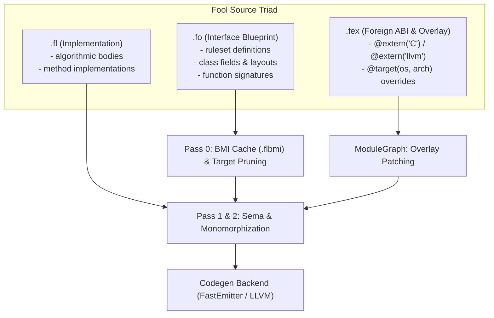

# The Fool Systems Programming Language (`foolc`)

> **Fool** is a modern systems programming language combining the raw control of C++, the memory ergonomics and transitive immutability of Rust, and a clean compile-time triad architecture.

---

## Table of Contents

- [Key Language Invariants](#key-language-invariants)
  - [1. File Triad Architecture (.fo / .fl / .fex)](#1-file-triad-architecture-fo--fl--fex)
  - [2. Mutability & Reference Model](#2-mutability--reference-model)
  - [3. Explicit Receivers](#3-explicit-receivers)
  - [4. Middle & Trailing Parameter Defaults](#4-middle--trailing-parameter-defaults)
  - [5. Nominal Capability Rulesets & Blueprints](#5-nominal-capability-rulesets--blueprints)
  - [6. Directive-Only Attribute System (@)](#6-directive-only-attribute-system-)
- [Repository Structure](#repository-structure)
- [The `foolc` Compiler Architecture](#the-foolc-compiler-architecture)
- [Standard Library (`stdlib/`)](#standard-library-stdlib)
- [Examples & Test Suite](#examples--test-suite)
- [VS Code / Cursor IDE Extension](#vs-code--cursor-ide-extension)
- [Building the Compiler](#building-the-compiler)
- [License](#license)

---

## Key Language Invariants

### 1. File Triad Architecture (`.fo` / `.fl` / `.fex`)

Fool replaces legacy C/C++ header files and monolithic source translation units with a strict, compiler-enforced triad:

| Extension | Role | Contents | Invariants |
| :--- | :--- | :--- | :--- |
| **`.fo`** | **Interface Blueprint** | Declarations, nominal `ruleset` capability bounds, `class` memory layouts, `blueprint` templates, and public function signatures. | **Zero executable bodies**. Compiled into Binary Module Interfaces (`.flbmi`). |
| **`.fl`** | **Implementation Unit** | Pure Fool algorithmic logic, method bodies, and state machine step transitions. | Declares `module <name>;`. **Never self-imports its companion `.fo`**. External `#import` allowed. |
| **`.fex`** | **External / Platform Overlay** | Foreign ABI bindings (`@extern("C")`, `@extern("llvm")`), kernel syscalls, and target-specific overrides. | Gated by `@target(os = "...", arch = "...")`. Merged in Pass 0. |



---

### 2. Mutability & Reference Model

Fool eliminates the verbose `mut` keyword in favor of clean, predictable mutability defaults:

- **No `mut` keyword exists in Fool**:
- **Mutable by Default**:
  - **Variables**: `counter = 0;` (or `var count: i32 = 0;`). In-place mutation is valid.
  - **References**: `&T` (e.g. `fn write(buffer: &Span<u8>)`).
  - **Pointers**: `*T` (e.g. `data: *u8`).
  - **Receivers**: `this &self` (e.g. `fn append(this &self, byte: u8) -> bool`).
- **Rust-like Strict Transitive Immutability with `const`**:
  - **Immutable Bindings**: `const val = 42;` (or `const val: i32 = 42;`). Reassignment is a compile-time error.
  - **Immutable References**: `const& T` (e.g. `fn read(data: const& Span<u8>)`).
  - **Immutable Pointers**: `const* T` (e.g. `bytes: const* u8`).
  - **Immutable Receivers**: `this const& self` (e.g. `fn len(this const& self) -> usize`).
  - *Semantics*: Complete transitive read-only protection. Calling `this &self` methods on a `const&` instance is prohibited.
- **Compile-Time Constants with `constx`**:
  - C++ `constexpr` / Rust `const` equivalent: `constx BUFFER_CAPACITY: usize = 4096;`. Evaluated strictly at compile time.

---

### 3. Explicit Receivers

Methods in Fool do not rely on implicit, hidden `this` pointers. The receiver is explicitly declared as the first parameter:

```fool
// 1. Immutable Borrow (Read-only query)
fn ByteBuffer::length(this const& self) -> usize {
    return self.len;
}

// 2. Mutable Borrow (In-place mutation, no 'mut' keyword)
fn ByteBuffer::append(this &self, byte: u8) -> bool {
    self.len = self.len + 1;
    return true;
}

// 3. Consuming Receiver (Destructive move / ownership transfer)
fn ByteBuffer::destroy(this self) {
    // self is consumed and invalidated at the caller
    return;
}
```

---

### 4. Middle & Trailing Parameter Defaults

Fool supports default expressions in **any** parameter slot, including middle positions:

```fool
// Signature in .fo:
async fn render_box(x: f32, y: f32, scale: f32 = 1.0, width: f32, height: f32) -> i32;

// Call sites:
render_box(10.0, 20.0, 1.0, 100.0, 200.0);       // Positional
render_box(10.0, 20.0, width: 100.0, height: 200.0); // Middle default preserved with named args
```

---

### 5. Nominal Capability Rulesets & Blueprints

Fool deliberately rejects class inheritance in favor of pure data structures and nominal capability bounds (`ruleset`):

```fool
// ruleset definition (C++ concept / Rust trait equivalent)
ruleset Equatable<T> {
    fn equals(this const& self, other: const& T) -> bool;
}

ruleset Printable<T: Equatable> {
    fn to_string(this const& self) -> StringView;
}

// Monomorphized compile-time template
blueprint VectorMath<SIMD: bool = false> {
    fn dot_product(a: const* f32, b: const* f32, len: usize) -> f32;
}
```

---

### 6. Directive-Only Attribute System (`@`)

`@` is strictly a compile-time attribute/directive marker, never a unary or binary expression operator:

```fool
@target(os = "windows", arch = "x86_64")
@extern("C", link_name = "VirtualAlloc")
fn win32_virtual_alloc(addr: *void, size: usize, alloc_type: u32, protect: u32) -> *void;
```

---

## Repository Structure

```
fool-origin/
├── .agent/                    # Antigravity rules and skills
│   ├── rules/                 # fool-language-rules.md, foolc-compiler-rules.md
│   └── skills/                # fool-authoring, foolc-compiler-dev
├── editors/
│   └── vscode/                # VS Code / Cursor extension source & packaging
│       ├── package.json
│       ├── language-configuration.json
│       ├── syntaxes/fool.tmLanguage.json
│       ├── snippets/fool.json
│       ├── build_vsix.py      # Standalone VSIX packager
│       └── fool-vscode-0.1.0.vsix
├── examples/                  # Fool Language Test Suite
│   ├── 01_basics.fo / .fl
│   ├── 02_receivers_and_mutability.fo / .fl
│   ├── 03_middle_defaults.fo / .fl
│   ├── 04_rulesets_and_blueprints.fo / .fl
│   ├── 05_target_pruning.fex
│   └── 06_full_program.fo / .fl
├── src/                       # foolc C++23 Compiler Implementation
│   ├── Common/                # Arena allocator, StringInterner, SourceLocation
│   ├── Lexer/                 # Zero-copy tokenizer
│   ├── AST/                   # Arena-allocated AST nodes & statements
│   ├── Parser/                # Pratt & recursive descent parser with error recovery
│   ├── Sema/                  # Pass 0 Target Pruning, Symbol Tables
│   └── main.cpp               # Driver CLI and test runner
├── stdlib/                    # Standard Library (52 files across 7 subsystems)
│   ├── core/                  # memory, span, atomic, rulesets
│   ├── io/                    # file I/O, platform syscall bindings
│   ├── sync/                  # mutex, channel, platform futex/wait
│   ├── async/                 # event loops (epoll, kqueue, iocp, wasm), futures
│   ├── net/                   # tcp sockets
│   ├── math/                  # scalar and SIMD vector math
│   └── sys/                   # process and environment
├── CMakeLists.txt             # Modern CMake build configuration
└── fool-vscode-0.1.0.vsix     # Packaged VSIX ready for installation
```

---

## The `foolc` Compiler Architecture

The `foolc` compiler is written in modern C++23 using C++ modules (`.ixx` interface partitions, `.cpp` implementation units) and enforces strict architectural invariants:

1. **Strict Class Layout Invariant**:
   Every class and struct declaration in `src/` follows the 3-section ordering:
   - **Member variables FIRST on top** with the `m_` prefix.
   - **Constructors and Destructors in the MIDDLE**.
   - **Member functions LAST at the bottom**.

2. **Linear Bump Allocation (`fool::Arena`)**:
   AST nodes, statements, and semantic symbols are bump-allocated in a continuous memory arena, ensuring cache locality and zero individual heap allocation overhead.

3. **String Interning (`fool::StringInterner`)**:
   Identifiers, tokens, and symbols are interned into compact 32-bit `SymbolID` values for fast $O(1)$ equality comparisons.

4. **Multi-Pass Compilation Pipeline**:
   - **Pass 0 (Target Pruning)**: Evaluates `@target(os, arch, pointer_width)` attributes, discarding inactive platforms before AST analysis.
   - **Pass 1 (Symbol Resolution)**: Constructs module dependency graphs and verifies ruleset contracts.
   - **Pass 2 (Type Checking)**: Enforces immutability on `const&`, validates `constx` compile-time values, and validates receivers.
   - **Opt-In Borrow Checker**: Static lifetime graphs and alias XOR mutability verification via `--check-borrow`.

---

## Standard Library (`stdlib/`)

The standard library provides foundational primitives implemented across the `.fo`, `.fl`, and `.fex` triad:

- **`std::core`**: Memory management, bump allocation, `Span<T>`, `Atomic<T>`, and fundamental capability rulesets (`Equatable`, `Comparable`, `Hashable`, `Clone`).
- **`std::io`**: High-performance buffered I/O with platform-specific syscall overlays (`posix`, `win32`, `wasi`).
- **`std::sync`**: Cross-platform lightweight `Mutex<T>` (using Futex on Linux, `WaitOnAddress` on Windows, `ulock` on macOS) and thread-safe MPMC `Channel<T>`.
- **`std::async`**: Async runtimes and event loops optimized for `epoll` (Linux), `iocp` (Windows), `kqueue` (macOS), and WebAssembly.
- **`std::net`**: Non-blocking TCP sockets.
- **`std::math`**: SIMD-accelerated linear algebra blueprints.
- **`std::sys`**: Process control and OS-level metadata.

---

## Examples & Test Suite

The `examples/` directory contains verified test cases:

| Example | Tested Capabilities |
| :--- | :--- |
| [`01_basics`](examples/01_basics.fo) | `constx`, `const` immutable variables, `=` mutable variables, control flow. |
| [`02_receivers_and_mutability`](examples/02_receivers_and_mutability.fo) | `this const& self`, `this &self`, `this self`, `*T` vs `const* T`. |
| [`03_middle_defaults`](examples/03_middle_defaults.fo) | Middle and trailing default parameters in functions and `async fn`. |
| [`04_rulesets_and_blueprints`](examples/04_rulesets_and_blueprints.fo) | Nominal contracts (`ruleset`), monomorphized templates (`blueprint`). |
| [`05_target_pruning`](examples/05_target_pruning.fex) | Foreign ABI bindings and Pass 0 `@target(...)` pruning. |
| [`06_full_program`](examples/06_full_program.fo) | End-to-end sample application with `#import` and state transitions. |

---

## VS Code / Cursor IDE Extension

A complete Visual Studio Code / Cursor extension is provided in `editors/vscode/` and packaged as [`fool-vscode-0.1.0.vsix`](fool-vscode-0.1.0.vsix).

### Installation:

```bash
code --install-extension fool-vscode-0.1.0.vsix
```

Or in the editor:
1. Open the Extensions view (`Ctrl + Shift + X`).
2. Click `...` in the upper-right corner.
3. Select **Install from VSIX...** and choose `fool-vscode-0.1.0.vsix`.

---

## Building the Compiler

The compiler requires a modern C++23 compiler (MSVC 19.38+ / Clang 17+ / GCC 14+) with C++ modules support and CMake 3.28+.

```bash
mkdir build && cd build
cmake ..
cmake --build .
```

To run the test suite:
```bash
./bin/foolc
```
Or test a specific source file:
```bash
./bin/foolc ../examples/01_basics.fl
```

### Running Tests with CTest:
```bash
ctest --output-on-failure
```
Or run a specific test filter:
```bash
ctest -R foolc_test_examples --output-on-failure
ctest -R foolc_test_stdlib --output-on-failure
```

---

## License

This project is licensed under the MIT License. See [LICENSE](editors/vscode/LICENSE) for details.

