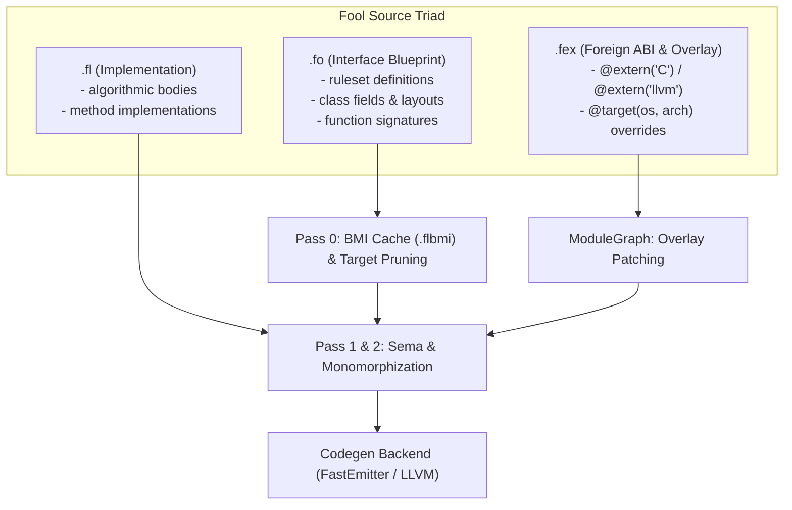

# The Fool Systems Programming Language (`foolc`)

> **Fool** is a modern systems programming language combining the raw control of C++, the memory ergonomics and transitive immutability of Rust, and a clean compile-time triad architecture.

---

## Table of Contents

- [Key Language Invariants](#key-language-invariants)
  - [1. File Triad Architecture (.fo / .fl / .fex)](#1-file-triad-architecture-fo--fl--fex)
  - [2. Mutability & Reference Model](#2-mutability--reference-model)
  - [2d. Optional Types (`T?`)](#2d-optional-types-t)
  - [2f. Lambdas, Function Types and Explicit Captures](#2f-lambdas-function-types-and-explicit-captures)
  - [2g. Serialization and Reflection (`$serialize`)](#2g-serialization-and-reflection-serialize)
  - [2h. Loops](#2h-loops)
  - [3. Explicit Receivers](#3-explicit-receivers)
  - [4. Middle & Trailing Parameter Defaults](#4-middle--trailing-parameter-defaults)
  - [5. Nominal Capability Rulesets & Blueprints](#5-nominal-capability-rulesets--blueprints)
  - [6. Directive-Only Attribute System (@)](#6-directive-only-attribute-system-)
- [Documentation (`docs/`)](#documentation)
- [Repository Structure](#repository-structure)
- [The `foolc` Compiler Architecture](#the-foolc-compiler-architecture)
- [Standard Library (`stdlib/`)](#standard-library-stdlib)
- [Examples & Test Suite](#examples--test-suite)
- [IDE Extensions (VS Code, Cursor, CLion, JetBrains)](#ide-extensions)
  - [VS Code / Cursor](#vs-code--cursor)
  - [CLion & JetBrains IDEs](#clion--jetbrains-ides)
- [Building the Compiler](#building-the-compiler)
- [License](#license)

---

## Key Language Invariants

### 1. File Triad Architecture (`.fo` / `.fl` / `.fex`)

Fool replaces legacy C/C++ header files and monolithic source translation units with a strict, compiler-enforced triad:

| Extension | Role | Contents | Invariants |
| :--- | :--- | :--- | :--- |
| **`.fo`** | **Interface Blueprint** | Declarations, nominal `ruleset` capability bounds, `class` memory layouts, `blueprint` templates, and public function signatures. | **Zero executable bodies**. Cached as Binary Module Interfaces (`.flbmi`, see below). |
| **`.fl`** | **Implementation Unit** | Pure Fool algorithmic logic, method bodies, and state machine step transitions. | Declares `module <name>;`. **Never self-imports its companion `.fo`**. External `#import` allowed. |
| **`.fex`** | **External / Platform Overlay** | Foreign ABI bindings (`@extern("C")`, `@extern("llvm")`), kernel syscalls, and target-specific overrides. | Gated by `@target(os = "...", arch = "...")`. Merged in Pass 0. |

Declarations are private to their file unless written `pub` (files sharing a name stem, such as `store.fo`, `store.fl` and
`store_linux.fex`, count as one file); members of a class are public only when marked `pub` inside the class, and
`pub namespace n { ... }` makes everything in it public. See [`docs/language.md`](docs/language.md).

Pairing every `.fo` with a `.fl` is the preferred layout but not required: a `.fo` on its own is a valid, complete module
(types, constants and signatures whose implementation lives elsewhere), and importers type-check their calls against it.
(`tests/project/interface_only`, and `stdlib/core/rulesets.fo` / `stdlib/sys/*.fo` in the standard library.)



---

### 2. Mutability & Reference Model

Fool eliminates the verbose `mut` keyword in favor of clean, predictable mutability defaults:

- **No `mut` keyword exists in Fool**:
- **Mutable by Default**:
  - **Variables**: `counter = 0;` (or `var count: i32 = 0;`). In-place mutation is valid.
  - **References**: `&T` (e.g. `fn write(buffer: &Span<u8>)`).
  - **Pointers**: `*T` (e.g. `data: *u8`).
  - **Receivers**: `this &self` (e.g. `fn append(this &self, byte: u8) -> bool`).
- **Rust-like Strict Transitive Immutability with `const`**:
  - **Immutable Bindings**: `const val = 42;` (or `const val: i32 = 42;`). Reassignment is a compile-time error.
  - **Immutable References**: `const& T` (e.g. `fn read(data: const& Span<u8>)`).
  - **Immutable Pointers**: `const* T` (e.g. `bytes: const* u8`).
  - **Immutable Receivers**: `this const& self` (e.g. `fn len(this const& self) -> usize`).
  - *Semantics*: Complete transitive read-only protection. Calling `this &self` methods on a `const&` instance is prohibited.
- **Compile-Time Constants with `constx`**:
  - C++ `constexpr` / Rust `const` equivalent: `constx BUFFER_CAPACITY: usize = 4096;`. Evaluated strictly at compile time.

---

### 2b. Scopes & Shadowing

Fool follows C++ block scoping. A `{ ... }` block, an `if`/`while` body, a `for` loop (the variable its initializer declares, plus the body) and every
branch of a compile-time `@if` open a new scope. A name declared in a nested scope **shadows** the same name from an
enclosing scope until the end of its block; afterwards the outer name is visible again and was never modified:

```fool
fn run(count: i32) -> i32 {
    var total = 1;
    {
        var total = 2;        // shadows the outer `total`
        total = total + 1;    // changes the inner variable only
    }
    if (count > 0) {
        var count = 5;        // shadows the parameter inside this block
        total = total + count;
    }
    return total;             // the outer `total`
}
```

- Redeclaring a name **in the same scope** is an error, including a parameter at the top level of the function body
  (`redefinition of 'x' in this scope`), exactly as in C++.
- Shadowing also applies to `constx`: a local that shadows a constant hides its compile-time value inside the block.
- One deliberate difference from C++: a declaration's initializer is evaluated *before* the new name enters scope, so
  `var total = total + 1;` in a nested block reads the outer `total` instead of the variable being declared.
- `foolc --warn-shadow` reports every declaration that hides a variable of an enclosing scope or a global variable
  (with a note at the hidden declaration), like C++ `-Wshadow`; `-Werror` turns warnings into a failing exit code.
  Sibling scopes reusing a name do not count as shadowing. Test files can assert warnings with `// expect-warning: <text>`.
- The checker, the const evaluator and the borrow checker all use the same scoping, so a shadowing variable is never
  confused with the one it hides.

---

### 2c. Casts

`expr as T` stays as the unchecked, C-style conversion (needed for FFI and low-level code; it wraps instead of failing).
Everything else is spelled as a named cast, `@name<T>(expr)`, and is validated by the checker:

| Cast | Allowed conversions | Rejected with an error |
| :--- | :--- | :--- |
| `@static_cast<T>(x)` | integer / float / `bool`-to-integer conversions, `*void` ⇄ `*U`, `&T` → `*T`, adding `const` | pointer ⇄ integer, unrelated pointee types, removing `const`, `*T` → `&T`, anything → `bool` (compare explicitly), a **constant** that does not fit the target |
| `@dynamic_cast<*T>(x)` | checked downcast of a ruleset view (`&Shape` / `*Shape`) to a class or struct pointer; the result is `null` when the dynamic type is not `T` | non-pointer target, primitive / ruleset / enum target, operand that is not a ruleset view, removing `const` |
| `@reinterpret_cast<T>(x)` | pointer ⇄ pointer, pointer ⇄ **pointer-sized** integer (`usize` / `isize`, width taken from `--target`), `&T`/`*T` → `*U` | removing `const`, producing a reference, any other pair (it points you to `@static_cast` or `@bit_cast`) |
| `@bit_cast<T>(x)` | reinterpret the bytes of a value as another type of **exactly the same size** (`f32` ⇄ `u32`, a struct ⇄ an integer, ...) | different sizes (both are printed), references, types of unknown size |

```fool
var bits  = @bit_cast<u32>(ratio);            // f32 -> u32, same 4 bytes
var small = @static_cast<u8>(300);            // error: constant 300 does not fit in 'u8'
var addr  = @reinterpret_cast<usize>(raw);    // pointer -> pointer-sized integer
var sq    = @dynamic_cast<*Square>(shape);    // null unless `shape` really is a Square
```

- Sizes follow natural C layout (fields in declaration order, padded to their alignment) and use the target's pointer width.
- `@static_cast` and `@bit_cast` between scalars (and `as`) are folded inside `constx` initializers, e.g.
  `constx ONE_BITS: u32 = @bit_cast<u32>(@static_cast<f32>(1.0));`. Pointer casts are never constant.
- Type information is inferred conservatively (literals adapt to the type they are cast through; generics and values
  of unknown type skip the check instead of guessing).
- `@dynamic_cast` is only type-checked today: classes do not declare which rulesets they implement and there is no
  code generator yet, so conformance and the runtime type test are future work.

### 2d. Optional Types (`T?`)

A value that may be absent has an optional type. `null` is the empty value and only an optional can hold it:

```fool
fn find(id: i32) -> Entity?;                 // may return null

fn tick(a: Entity?) {
    var found: Entity? = find(1);
    if (a) { update(&a); }                   // `a` is a plain Entity inside the branch
    if (found == null) { return; }
    found.id = 3;                            // narrowed for the rest of the block
}
```

- `T` converts to `T?` and `U?` converts to `T?` when `U` converts to `T`. `T?` never converts back to `T`, and
  `null` never converts to a non-optional type; both are compile errors, with a hint.
- Using the value (`a.field`, `a.method()`, `*a`, `a[i]`) needs the compiler to see that it holds a value. Variables
  (including parameters) are narrowed by `if (a)`, `a != null`, `a == null` (the other branch), `!a`, `&&` / `||`
  (for the right operand), an early `return` / `break` / `continue` in `if (a == null) { ... }`, a loop condition
  and by initializing or assigning a plain value. Assigning anything else, or taking `&a`, forgets it; a loop body
  that assigns the variable starts without it. Fields, globals and call results are never narrowed: bind them to a
  local first.
- `if` / `while` conditions accept an optional (true = holds a value). `==` / `!=` only compare with `null`;
  arithmetic and ordering on an optional are errors.
- `*T?` is a nullable pointer (the `?` applies to the whole type), `@dynamic_cast<*T?>(p)` states that the result may be
  null. An optional field that a struct literal leaves out starts as `null`. `T??` is rejected.

### 2e. Refactor-friendly member access

`.` reaches a member whether the left side is a value, a reference or a pointer, so `p.x` keeps working when a
variable changes from `T` to `&T` or `*T`. The constness of the view still applies (`const& T` is read-only).

### 2f. Lambdas, Function Types and Explicit Captures

Functions and lambdas share one syntax, `(params) -> result { body }`; giving it a name declares a function:

```fool
double_it = (x: i32) -> i32 { return x * 2; };           // module level: same as `fn double_it(x: i32) -> i32 { ... }`

fn demo() {
    twice = (x: i32) -> i32 { return x * 2; };            // inside a function: a variable holding a lambda
    twice(3);  twice(x = 3);                              // parameter names (and defaults) work like a function's
    var f: fn(i32) -> i32 = twice;                        // `fn(A, B) -> R` is the type of a function value
}
```

A lambda has no access to the code around it unless it says so. Its body can use its parameters, its own
locals, the variables in its capture list, and program-wide functions, types and constants (including immutable
`const` / `constx` globals). Any other variable of the enclosing code, and any mutable global, is a compile
error that names the variable and suggests the capture list:

```fool
fn scale(factor: i32) -> i32 {
    var total: i32 = 0;
    add = (n: i32) -> i32 capture=[total, factor] { total = total + n * factor; return total; };

    // A block after a call is a lambda with no parameters, passed as the last argument:
    thread_task(capture=[data1, data2]) {
        // only data1, data2, locals, constants and functions can be named here
    }
}
```

- Captured variables are shared with the enclosing code (captured by reference) and keep their type, constness
  and moved state. An optional is not narrowed inside the lambda: check it again there.
- `capture=[...]` must be followed by a block when written on a call. A function declaration (`name = (...) { }`)
  cannot capture. A call that ends in a block needs no `;`.
- `thread_task` is an ordinary function whose last parameter has a function type, e.g. `fn thread_task(task: fn())`.
- Calls through a variable that still holds its lambda use that lambda's parameter names; through any other
  function value (a parameter, a field) they are positional and checked against its `fn(...)` type.
- The guarantee covers names written in the body: what a *called* function does with other globals is not tracked.
- Lambda bodies are borrow-checked like functions (`--check-borrow`). Holding a borrow for as long as the lambda lives
  is not modelled yet, and there is no code generation for lambdas yet.

---

### 2g. Serialization and Reflection (`$serialize`)

A type opts in to serialization with one attribute; there is no per-type boilerplate:

```fool
$serialize(format = "json")                 // format is json (default), binary or text
struct Player {
    id: i32;
    name: StringView;
    position: Vec2;                         // must itself be $serialize
    score: f64?;                            // optionals are written as their value or as null
    partner: Player?;                       // recursive types are fine
}

fn save(p: Player) -> StringView {
    return serialize(p);                    // built-in: any serializable value -> StringView
}
```

- `$serialize` applies to classes, structs and enums. Every field (and every variant payload) is checked: numbers, `bool`,
  `StringView`, optionals of those, generic parameters (judged at instantiation) and other `$serialize` types are fine.
  Pointers, references and function values are rejected, with the reason, at the field.
- `serialize(x)` takes exactly one unnamed argument (references are looked through) and has type `StringView`. A type
  that is not marked `$serialize` is an error that tells you to mark it. A function, variable or global named
  `serialize` in scope replaces the built-in.
- `$serialize` is the only `$` directive; `@serialize` is a parse error that says so.
- Reflection is written with `&`, and works on a type or a variable: `&field_count(T)` (`usize`, classes and structs only),
  `&type_name(T)` (`StringView`) and `&is_serializable(T)` (`bool`). `&` followed by one of these three names and `(` is always reflection, never
  address-of (`@field_count(...)` is a parse error). They are type-checked; they are not evaluated at
  compile time yet.
- `foolc --dump-reflection file.fl` prints the metadata the checker derived: each `$serialize` type with its format and
  field count, and for every field whether it is `[ok]` or `[not serializable: reason]`.
- Limits: there is no code generation, and no `deserialize` yet (it needs a call that takes a type argument).

---

### 2h. Loops

`while` takes a condition (parentheses are optional): `while (i < n) { ... }`. `for` is written the way C++ writes it, so
the loop variable's type, its starting value and the step are all visible at the loop and nothing is implied about
size or direction:

```fool
for (var i: usize = 0; i < n; i = i + 1) { ... }       // up, one at a time
for (var i: usize = n; i > 0; i = i - 1) { ... }       // down; stops before wrapping below zero
for (var i = 0; i < limit; i = i + 3) { ... }          // every third; `var i = 0` is an i32 like anywhere else
for (var x: f32 = 0.0; x < 1.0; x = x + 0.25) { ... }  // a non-integer step is just as explicit
for (; i < limit; ) { ... }                            // each of the three parts may be left out
for (;;) { ... }                                       // until `break` or `return`
```

- The header is `(init; condition; step)`. `init` is a declaration or an expression statement, `condition` must be
  a `bool` (or an optional, like any condition) and `step` is an expression that runs after every iteration, **also
  after `continue`**.
- The variable declared by `init` belongs to the loop: it is visible in the condition, the step and the body, and
  not after the loop, so the next loop can reuse the name. It is a normal variable (a `const` one cannot be stepped).
- There is no `for x in a..b` form and no iteration protocol yet; writing `for i in ...` is a parse error that shows the
  right spelling. `in` stays a reserved word for the day iteration over collections is designed.

---

### 3. Explicit Receivers

Methods in Fool do not rely on implicit, hidden `this` pointers. The receiver is explicitly declared as the first parameter:

```fool
// 1. Immutable Borrow (Read-only query)
fn ByteBuffer::length(this const& self) -> usize {
    return self.len;
}

// 2. Mutable Borrow (In-place mutation, no 'mut' keyword)
fn ByteBuffer::append(this &self, byte: u8) -> bool {
    self.len = self.len + 1;
    return true;
}

// 3. Consuming Receiver (Destructive move / ownership transfer)
fn ByteBuffer::destroy(this self) {
    // self is consumed and invalidated at the caller
    return;
}
```

---

### 4. Middle & Trailing Parameter Defaults

Fool supports default expressions in **any** parameter slot, including middle positions:

```fool
// Signature in .fo:
async fn render_box(x: f32, y: f32, scale: f32 = 1.0, width: f32, height: f32) -> i32;

// Call sites:
render_box(10.0, 20.0, 1.0, 100.0, 200.0);       // Positional
render_box(10.0, 20.0, width: 100.0, height: 200.0); // Middle default preserved with named args
render_box(10.0, 20.0, width = 100.0, height = 200.0); // `name = value` is the same label
```

Inside a call's argument list `name = value` is always a label, never an assignment, and is checked like `name: value`
(unknown or repeated names, a positional argument after a named one, missing arguments and mismatched types are errors).

---

### 5. Nominal Capability Rulesets & Blueprints

Fool deliberately rejects class inheritance in favor of pure data structures and nominal capability bounds (`ruleset`):

```fool
// ruleset definition (C++ concept / Rust trait equivalent)
ruleset Equatable<T> {
    fn equals(this const& self, other: const& T) -> bool;
}

ruleset Printable<T: Equatable> {
    fn to_string(this const& self) -> StringView;
}

// Monomorphized compile-time template
blueprint VectorMath<SIMD: bool = false> {
    fn dot_product(a: const* f32, b: const* f32, len: usize) -> f32;
}
```

---

### 6. Directive-Only Attribute System (`@`)

`@` is strictly a compile-time attribute/directive marker, never a unary or binary expression operator:

```fool
@target(os = "windows", arch = "x86_64")
@extern("C", link_name = "VirtualAlloc")
fn win32_virtual_alloc(addr: *void, size: usize, alloc_type: u32, protect: u32) -> *void;
```

---

### 7. Parameterized Module Imports & Conditional Directives (`@if def(...)`)

In C/C++, libraries frequently depend on `#define CONFIG_FLAG` macros placed before `#include` to configure dependencies from the call site. Fool replaces this with hygienic **Module Templates** and **Import Templates**:

**Module Definition (with default values):**
```fool
module name1<ASIO_IOURING_ON = 1, INIT = 0>; // declared with default values

@if def(ASIO_IOURING_ON) && (ASIO_IOURING_ON == 1)
fn func1() {
    // Compiled when ASIO_IOURING_ON is active and equal to 1
}
```

**Consumer Import Sites:**
```fool
// 1. With explicit compile-time overrides:
#import name1<ASIO_IOURING_ON = 1>;   // a path: the file `name1` (or folder) next to this one

// 2. Or using the module's default values:
#import name1;
```

Dependent modules cleanly supply configuration values down to dependencies without global preprocessor macro leakage.

---

## Documentation

Two documents in [`docs/`](docs/) go deeper than this README:

- [`docs/language.md`](docs/language.md): the Fool language itself, from lexical rules to modules, types, statements and directives.
- [`docs/source-structure.md`](docs/source-structure.md): how the `foolc` source tree is organised, which module does what, and how a file travels through the passes.

---

## Repository Structure

```
fool-origin/
├── .agent/                    # Antigravity rules and skills
│   ├── rules/                 # fool-language-rules.md, foolc-compiler-rules.md
│   └── skills/                # fool-authoring, foolc-compiler-dev
├── editors/
│   └── vscode/                # VS Code / Cursor extension source & packaging
│       ├── package.json
│       ├── language-configuration.json
│       ├── syntaxes/fool.tmLanguage.json
│       ├── snippets/fool.json
│       ├── build_vsix.py      # Standalone VSIX packager
│       └── fool-vscode-0.1.0.vsix
├── examples/                  # Fool Language Test Suite
│   ├── 01_basics.fo / .fl
│   ├── 02_receivers_and_mutability.fo / .fl
│   ├── 03_middle_defaults.fo / .fl
│   ├── 04_rulesets_and_blueprints.fo / .fl
│   ├── 05_target_pruning.fex
│   └── 06_full_program.fo / .fl
├── src/                       # foolc C++23 Compiler Implementation
│   ├── Common/                # Arena allocator, StringInterner, SourceLocation
│   ├── Lexer/                 # Zero-copy tokenizer
│   ├── AST/                   # Arena-allocated AST nodes & statements
│   ├── Parser/                # Pratt & recursive descent parser with error recovery
│   ├── Sema/                  # Pass 0 pruning + const-eval, Pass 1 module graph, Pass 2 checker, borrow checker
│   ├── HIR/                   # HIR v1: typed, resolved, desugared function bodies lowered from the checked AST
│   ├── MIR/                   # MIR v1: control-flow graph of basic blocks built from the HIR, with a verifier
│   ├── Module/                # `.flbmi` cache: SHA-256, binary parse-tree codec, on-disk cache manager
│   └── main.cpp               # Driver CLI (file / project / expect-error test modes)
├── docs/                      # language.md (the language) and source-structure.md (the compiler's source tree)
├── stdlib/                    # Standard Library (52 files across 7 subsystems)
│   ├── core/                  # memory, span, atomic, rulesets
│   ├── io/                    # file I/O, platform syscall bindings
│   ├── sync/                  # mutex, channel, platform futex/wait
│   ├── async/                 # event loops (epoll, kqueue, iocp, wasm), futures
│   ├── net/                   # tcp sockets
│   ├── math/                  # scalar and SIMD vector math
│   └── sys/                   # process and environment
├── tests/                     # positive/negative/borrow/warn regression tests, project and cache fixtures
├── CMakeLists.txt             # Modern CMake build configuration (Ninja + C++23 modules)
├── CMakePresets.json          # `cmake --preset default`
└── fool-vscode-0.1.0.vsix     # Packaged VSIX ready for installation
```

---

## The `foolc` Compiler Architecture

The `foolc` compiler is written in modern C++23 using C++ modules (`.ixx` interface partitions, `.cpp` implementation units) and enforces strict architectural invariants:

1. **Strict Class Layout Invariant**:
   Every class and struct declaration in `src/` follows the 3-section ordering:
   - **Member variables FIRST on top** with the `m_` prefix.
   - **Constructors and Destructors in the MIDDLE**.
   - **Member functions LAST at the bottom**.

2. **Linear Bump Allocation (`fool::Arena`)**:
   AST nodes, statements, and semantic symbols are bump-allocated in a continuous memory arena, ensuring cache locality and zero individual heap allocation overhead.

3. **String Interning (`fool::StringInterner`)**:
   Identifiers, tokens, and symbols are interned into compact 32-bit `SymbolID` values for fast $O(1)$ equality comparisons.

4. **Multi-Pass Compilation Pipeline**:
   - **Pass 0 (Target Pruning)**: Evaluates `@target(os, arch, pointer_width)` attributes (several `@target`s are OR'd, keys inside one are AND'd; `os = "posix"` matches linux/darwin/BSDs), top-level and statement-level `@if` conditions, module parameters and `constx` values. Platform files are selected by stem suffix (`_linux`, `_posix`, `_windows`, `_wasm`, `_wasi`, ...). The AST is never mutated, so one tree can be checked under several instantiations.
   - **Pass 1 (Module Graph)**: Indexes files by their declared module name, resolves `#import`s (including template arguments), reports unresolved/self/cyclic imports and produces a topological compilation order.
   - **Pass 2 (Type Checking)**: Declaration consistency between `.fo` and `.fl`, duplicate fields/variants/definitions, `const`/`const&`/`const*` immutability, `this` receiver rules, use-after-move for consuming receivers, named/default argument binding, expression types and implicit-conversion rules, struct-literal field checks, `constx` evaluation with integer range and overflow checks, return-path analysis, `break`/`continue` placement.

### Expression types and implicit conversions

Pass 2 infers a type for every expression it visits (`--dump-types` prints them; `TypeCheckerPass2::expression_types()` is
the table HIR lowering will read) and rejects implicit conversions that lose information. A literal adapts to the type it
is used as; the rest is explicit.

| Allowed implicitly | Needs `@static_cast` / `@bit_cast` / `@reinterpret_cast` |
| :--- | :--- |
| integer to a wider integer of the same signedness; unsigned to a strictly wider signed integer | narrowing, or changing signedness (`i64`→`i32`, `u32`→`i32`) |
| `f32` to `f64` | `f64`→`f32`; integer ↔ float; `bool` ↔ number (`x != 0`) |
| `&T` ↔ `*T`; adding `const` to a view | removing `const`; changing a primitive pointee (`*i32`→`*u8`); integer → pointer |
| class `A` to class `A` | class `A` to unrelated class `B` (rulesets and enums are not judged: conformance is not modelled) |

Where it applies: initializers, assignments, `return`, call arguments (non-generic callees), struct-literal fields,
arithmetic/comparison operands (one side must convert to the other), `&&`/`||` operands, and `if`/`while` conditions,
which must be `bool`. `!` is logical not on a `bool` and bitwise complement on an integer.

The check is deliberately conservative: a type the checker cannot determine (generic parameters, names from modules it
cannot see, results of unresolved calls) is never reported, so a missed error is possible but a wrong one should not be.
An unannotated `var x = 1;` keeps the type "integer literal" (adapting to later uses) here; the width it ends up with
is decided by HIR lowering (see "HIR v1" below).

### HIR v1

`foolc --dump-hir file.fl` lowers every function the checker accepted into the high-level IR and prints it
(`src/HIR/`). Compared with the AST, the HIR has settled everything a back end would otherwise have to guess:

- **One concrete type per expression.** A literal takes the type of its context (`x: u8 = 7`, `scale: f32 = 3`,
  `n + 1` with `n: i64`) and defaults to `i32` / `f64`; a local such as `sum = 0;` that a later use needs as another
  numeric type (`return sum;` in a function returning `f32`) gets that type. A string literal is a `StringView`,
  or `const* u8` where one is expected.
- **Names are resolved:** locals by index (`x#2`, shadowing is gone), globals (`::counter`), callees.
- **Conversions are explicit:** widening, `&T` <-> `*T`, adding `const`, `T` -> `T?` (`wrap`), a narrowed `T?` used as `T`
  (`unwrap`), `a != null` for a condition on an optional, and the four cast spellings.
- **Calls list their arguments in parameter order** with defaults filled in (labels are gone) and the receiver first;
  a method called on a value takes its address, one called through a view passes it on.
- **Member access is explicit:** `p.x` with `p: &T` is `(field (deref p) .x)`; an omitted optional field is `null`.
- **Compile-time `@if` is gone:** only the active branch remains, as a block.

```text
fn Counter::bump(self: &Counter, by: i32, times: i32) -> i32 {
  (= (field (deref self#0) .value) (+ (field (deref self#0) .value) (* by#1 times#2)));
  return (field (deref self#0) .value);
}

fn use_counter(p: &Counter) -> i32 {
  let c#1: Counter = (new Counter 1:i32 (new Vec2 0.0:f32 1.5:f32));
  let a#2: i32 = (call Counter::bump (addr c#1) 1:i32 2:i32);      // `by` filled with its default
  ...
```

Generics are **monomorphized**. A generic function (`identity<T>`), a method of a generic type (`Box<T>::get`) and
a generic class (`Box<i32>` is its own instance type with its own field types) are lowered once per set of type
arguments that a call or a type mentions, starting from the non-generic functions; the generic declaration itself stays
in the dump as `fn identity<T>: generic template`. Type arguments come from the call's arguments (`identity(3)` is
`identity<i32>`, `larger(wide, 3)` is `larger<i64>` because the literal adapts), from the receiver (`boxed.get()` on a
`Box<i32>`) or from written arguments (`Box<i64>::make(6)`); a literal takes the type another argument already fixed. An
instance is named by its arguments (`Box<Box<bool>>::make`), is lowered once however many calls ask for it, and may
itself request further instances (a generic function calling `Box<T>::make`). At most 1024 instances are made.

```text
let a#3: i32 = (call identity<i32> 3:i32);
let wide_box#11: Box<i64> = (call Box<i64>::make 6:i64);
let value#10: i32 = (call Box<i32>::get (convert:const& Box<i32> (addr boxed#9)));
...
fn Box<i32>::get(self: const& Box<i32>) -> i32 {
  return (field (deref self#0) .item);
}
```

`for (init; condition; step)` lowers to a Block holding the initializer and a `For` statement, so the loop variable has a
scope of its own. The step is a field of the `For`, not appended to the body, because `continue` must still run it;
an omitted condition means "until `break`":

```text
{
  let i#3: usize = 0:usize;
  for (< i#3 length#1) step (= i#3 (+ i#3 1:usize)) {
    (= total#2 (+ total#2 (index data#0 i#3)));
  }
}
```

Enums that the lowered code mentions are listed first in the dump (`enum Shape { Circle(f64), Rect(f64, f64), Empty }`).
A value is a `(variant Enum::Variant payload…)` expression whose payload values are converted to the declared payload
types, and `==` / `!=` are defined for enums whose variants carry no payload (ordering and comparing payload enums are
reported as not lowerable, since the language does not define them). The language has no `match` yet, so a payload can
be built but not read back.

What is not lowered is kept as `fn name: not lowerable yet: <reason> (line N)` instead of being skipped: lambdas, generic enums, qualified paths other than enum variants, constant generic arguments, async functions, reflection
intrinsics, function values, calls the checker could not bind, types and generic definitions from modules that are not
loaded (instantiation needs the definition's body, so a generic defined in another module is not instantiated yet), and
calls on a struct literal receiver (the checker does not bind them). The last line of the dump counts how many
functions were lowered and how many generic templates there are.

### MIR v1

`foolc --dump-mir file.fl` builds the next level down (`src/MIR/`) from the HIR, verifies it, and prints it. Where the
HIR is still a tree, the MIR is a **control-flow graph**: each function is a list of basic blocks (block 0 is the entry),
each block is straight-line statements and one terminator, and every statement does exactly one thing.

```text
fn sum(data: const* f32, length: usize) -> f32 {
  let total#2: f32;
  let i#3: usize;
  let _4: bool;
  bb0:
    total#2 = 0.0:f32
    i#3 = 0:usize
    goto bb1
  bb1:
    _4 = i#3 < length#1
    branch _4, bb2, bb4
  bb2:
    total#2 = total#2 + data#0[i#3]
    goto bb3
  bb3:
    i#3 = i#3 + 1:usize          // the step block: `continue` jumps here
    goto bb1
  bb4:
    return total#2
}
```

- **Control flow is blocks and jumps.** `if`, `while`, `for`, `break`, `continue` and early `return` become `goto`,
  `branch cond, then, else` and `return`. `&&` and `||` become a branch that writes a bool temporary, so the right operand
  only runs when it must. Code after a `return`/`break`/`continue` is dropped.
- **Evaluation order is explicit.** A compound expression is a sequence of statements writing temporaries (`_4`, printed as
  `_index`). A value read from a variable or memory is copied into a temporary first when a later operand makes a call, so
  `c.peek() + c.bump(5)` still reads the first operand before `bump` runs.
- **Places.** An assignable location is a local or global plus projections: `(*p#0)` dereference, `.field`, `[i#3]` index
  (the base is a pointer). Every projection records the type it produces.
- **Statements and terminators.** `place = rvalue`, `eval rvalue` (a call whose result is dropped), then `goto`, `branch`,
  `return` or `unreachable` (the end of a function whose every path returns). An rvalue is one of: a plain operand, a unary or
  binary operation, `convert`, `cast`, `&place`, `unwrap`, `wrap`, `new T {…}`, `variant Enum::V(…)` or `call f(…)`. There are
  no phi nodes: locals are mutable slots. Calls are ordinary rvalues because the language has no unwinding yet.
- **Types are the HIR's.** The MIR carries a copy of the HIR type table, so a type id means the same in both.
- **Verified.** `mir::verify` checks that every block ends in a terminator, every jump and local exists, projections fit the
  type they apply to, branch conditions are `bool`, assigned values have their place's type and returns match the function.
  `--dump-mir` reports a violation as an internal error; `--mir-selftest` feeds the verifier hand-built broken graphs; the
  test suite builds and verifies the MIR of every function of `stdlib/` and `examples/` that HIR lowers.

Functions HIR could not lower stay "not lowerable yet" with the same reason, and generic templates are represented by their
instantiations only. There is no optimization, no SSA and no code generation yet.

### Implementation status

| Area | Status |
| :--- | :--- |
| Lexer, Parser (Pratt, speculative generics, error recovery) | Implemented |
| Pass 0 pruning, `@if def(...)`, const evaluation | Implemented |
| Pass 1 module graph, import templates, cycle detection | Implemented |
| Pass 2 checks listed above, named casts | Implemented (name/type resolution is structural, not a full type system) |
| Expression types and implicit-conversion checks (`--dump-types`) | Implemented (conservative, see above) |
| Generics instantiation | Implemented in HIR lowering (monomorphization, see "HIR v1"); the checker still treats generic parameters as unknown types |
| Opt-in borrow checker (`--check-borrow`) | Implemented (intra-procedural, see below) |
| BMI cache (`.flbmi`): SHA-256 keyed parse-tree cache (`--cache`) | Implemented (see below) |
| Bound calls: canonical argument slots, defaults filled (`--dump-calls`) | Implemented (`name: v` and `name = v` labels) |
| Optional types `T?`, `null`, flow narrowing | Implemented (front end, checks and cache; no code generation yet) |
| Lambdas, `fn(...)` types, trailing blocks, explicit `capture=[...]` | Implemented (front end, checks and cache; no code generation yet) |
| `$serialize`, built-in `serialize(x)`, reflection intrinsics, `--dump-reflection` | Implemented (checks and metadata; no code generation yet) |
| HIR v1 (`--dump-hir`): typed, resolved, desugared bodies, generics monomorphized | Implemented (see above; unsupported functions are reported, not skipped) |
| MIR v1 (`--dump-mir`): control-flow graph of basic blocks built from the HIR, verified | Implemented (see above) |
| Code generation | **Planned** |

> Import-template instantiations are checked as separate runs of the importing module's dependency, but cross-module lookups currently use the default instantiation of the imported module.

---


## Standard Library (`stdlib/`)

The standard library provides foundational primitives implemented across the `.fo`, `.fl`, and `.fex` triad:

- **`std::core`**: Memory management, bump allocation, `Span<T>`, `Atomic<T>`, and fundamental capability rulesets (`Equatable`, `Comparable`, `Hashable`, `Clone`).
- **`std::io`**: High-performance buffered I/O with platform-specific syscall overlays (`posix`, `win32`, `wasi`).
- **`std::sync`**: Cross-platform lightweight `Mutex<T>` (using Futex on Linux, `WaitOnAddress` on Windows, `ulock` on macOS) and thread-safe MPMC `Channel<T>`.
- **`std::async`**: Async runtimes and event loops optimized for `epoll` (Linux), `iocp` (Windows), `kqueue` (macOS), and WebAssembly.
- **`std::net`**: Non-blocking TCP sockets.
- **`std::math`**: SIMD-accelerated linear algebra blueprints.
- **`std::sys`**: Process control and OS-level metadata.

---

## Examples & Test Suite

The `examples/` directory contains verified test cases:

| Example | Tested Capabilities |
| :--- | :--- |
| [`01_basics`](examples/01_basics.fo) | `constx`, `const` immutable variables, `=` mutable variables, control flow. |
| [`02_receivers_and_mutability`](examples/02_receivers_and_mutability.fo) | `this const& self`, `this &self`, `this self`, `*T` vs `const* T`. |
| [`03_middle_defaults`](examples/03_middle_defaults.fo) | Middle and trailing default parameters in functions and `async fn`. |
| [`04_rulesets_and_blueprints`](examples/04_rulesets_and_blueprints.fo) | Nominal contracts (`ruleset`), monomorphized templates (`blueprint`). |
| [`05_target_pruning`](examples/05_target_pruning.fex) | Foreign ABI bindings and Pass 0 `@target(...)` pruning. |
| [`06_full_program`](examples/06_full_program.fo) | End-to-end sample application with `#import` and state transitions. |
| [`07_import_templates`](examples/07_import_templates.fo) | Parameterized module imports (`#import mod<A=..., B=...>;`), replacing C++ `#define`. |

---

## IDE Extensions

### VS Code / Cursor

A complete Visual Studio Code / Cursor extension is provided in `editors/vscode/` and packaged as [`fool-vscode-0.1.0.vsix`](fool-vscode-0.1.0.vsix).

#### Installation:

```bash
code --install-extension fool-vscode-0.1.0.vsix
```

Or in the editor:
1. Open the Extensions view (`Ctrl + Shift + X`).
2. Click `...` in the upper-right corner.
3. Select **Install from VSIX...** and choose `fool-vscode-0.1.0.vsix`.

---

### CLion & JetBrains IDEs

Fool language support for **CLion**, **IntelliJ IDEA**, **Rider**, and other JetBrains IDEs is provided via the official TextMate bundle located in `editors/clion/Fool.tmbundle` and packaged as [`Fool.tmbundle.zip`](Fool.tmbundle.zip).

#### Features:
- Complete syntax highlighting for `.fo`, `.fl`, and `.fex` files.
- Support for `@if / @elif / @else`, `#import<...>`, and module template headers.
- Code commenting and uncommenting toggle with `Ctrl+/` (`Cmd+/` on macOS).
- Full keyword, receiver, type, and operator scopes.

#### 1-Minute Setup in CLion:
1. Open CLion and go to **Settings** (`Ctrl+Alt+S` on Windows/Linux, `Cmd+,` on macOS).
2. In the left tree, select **Editor** -> **TextMate Bundles**.
3. Click the **`+` (Add)** icon.
4. Select either:
   - The directory: [`editors/clion/Fool.tmbundle`](editors/clion/Fool.tmbundle)
   - Or the archive: [`Fool.tmbundle.zip`](Fool.tmbundle.zip)
5. Click **Apply** -> **OK**. All `.fo`, `.fl`, and `.fex` files will automatically receive full syntax highlighting!

---

## Building the Compiler

The compiler requires a C++23 compiler with named-module support (Clang 17+ with `clang-scan-deps`, GCC 14+, or MSVC 19.38+), CMake 3.28+ and **Ninja** (or Visual Studio). Makefile generators cannot build C++ modules.

```bash
cmake --preset default            # or: cmake -S . -B build -G Ninja
cmake --build build
./build/bin/foolc --help
```

If CMake picks the wrong scanner for Clang, pass it explicitly, e.g. `-DCMAKE_CXX_COMPILER=clang++ -DCMAKE_CXX_COMPILER_CLANG_SCAN_DEPS=/usr/bin/clang-scan-deps-18`.

### Using `foolc`

```bash
foolc                                   # project mode over stdlib/ and examples/
foolc --project -I stdlib -I examples   # explicit search roots
foolc --graph                           # also print the module compilation order
foolc --check-borrow                    # additionally run the opt-in borrow checker
foolc --warn-shadow -Werror             # warn about shadowing declarations; fail on any warning
foolc --dump-types file.fl              # inferred type of every expression
foolc --dump-hir file.fl                # lowered HIR of every function (or why it is not lowerable yet)
foolc --dump-mir file.fl                # MIR control-flow graph of every lowered function (verified before printing)
foolc --dump-reflection file.fl         # $serialize metadata: fields and why a field is not serializable
foolc --cache                           # reuse parsed files from .fool_cache/bmi (see "The .flbmi cache")
foolc --target windows-x86_64 --project # check a different target (default: linux-x86_64)
foolc examples/01_basics.fl             # parse + local checks for single files
```

Exit codes: `0` success, `1` diagnostics with errors (or failed expectations), `2` usage error.

**Expect-error tests.** A file containing `// expect-error: <text>` comments is checked in test mode and passes only if exactly those errors are reported. A trailing comment applies to its own line; a comment on its own line applies to the next line. See `tests/negative/`.

### Bound calls (`--dump-calls`)

Pass 2 binds every call's arguments to the callee's parameters and keeps the result (`ResolvedCall`): one slot per
parameter in declaration (ABI) order, filled either by the caller's argument or by the parameter's default
expression, plus the receiver object of a method call. Named arguments are moved into place and middle defaults are
filled, so later stages (HIR lowering) never look at labels again. Calls that failed binding are not recorded.
`foolc --dump-calls file.fl` prints the table, e.g. for `render_box(height: 200, width: 100, y: 20, x: 10, depth: 3)`:

```
call render_box (37:5): x=arg3 y=arg2 scale=default width=arg1 height=arg0 depth=arg4
```

`argN` is the position of the argument in the call as written, which is also the order the arguments must be
evaluated in. Nested calls are listed before the call that contains them. Golden files live in `tests/calls/`.

### The `.flbmi` cache

`foolc --cache` (or `--cache-dir <dir>`) stores the parse tree of every file it reads as a Binary Module Interface and
loads it again on the next run instead of lexing and parsing the file. It is off by default; the default directory is
`.fool_cache/bmi`, and deleting it is always safe.

```
key = SHA-256( format version || frontend fingerprint || source text || import template args || target triple )
```

- The key is derived from the file's *text*, so an unchanged file is found without parsing it. Whitespace or comment
  edits make a new entry; the old one is simply never read again.
- The *frontend fingerprint* is a hash of the lexer, parser, AST and codec sources computed by CMake, so a compiler that
  parses differently never reuses an entry written by another build.
- Template arguments are part of the key. Import templates are resolved after parsing, so today every instantiation shares
  the base entry (empty argument string); instantiated interfaces can get their own entries without a format change.
- An entry is `magic | version | key | SHA-256 of the payload | size | payload`. The payload holds a string table and
  the whole tree (declarations, signatures, bodies, spans), so a hit is indistinguishable from a fresh parse, including
  the line numbers in diagnostics. Anything that does not verify (wrong magic, version, key, size, hash, or a payload
  that does not decode within bounds) is counted as *rejected*, parsed normally and overwritten.
- Entries are written atomically (temporary file + rename), and only for files that parsed with no diagnostics, so a cache
  hit can never hide an error or warning. An unwritable cache directory costs nothing but the cache.
- `--bmi-roundtrip` runs a file on the tree decoded from its own encoding (what a hit would produce); `--bmi-selftest`
  checks SHA-256 against the FIPS test vectors, the key, the codec and the on-disk behaviour. Both are used by the test suite.

Caveat for compiler developers: when you add a field to an AST node, add it to `src/Module/BMICodec.cpp` as well and bump
`BMI_FORMAT_VERSION`. The round-trip test compares encodings, so a field the codec never writes is not caught by it.

### Opt-in borrow checker

`--check-borrow` runs after the type checker, on code that already type-checks. A borrow starts at
`var r = &x;` (exclusive) or `const r: const& T = &x;` / `&x as const* T` (shared) and ends at the last use of `r`
(non-lexical lifetimes; borrows declared outside a loop and used inside it live for the whole loop). Calls borrow
temporarily: `f(&x)` and `x.method()` with a `this &self` receiver. Reported errors:

- a second exclusive borrow, or a shared/exclusive overlap, of the same place (`x`, `x.field`; disjoint fields are fine)
- reading or assigning a place while it is borrowed (assignment: by any borrow; reading: by an exclusive one)
- aliasing arguments within one call, e.g. `swap(&x, &x)`
- returning a reference to a local variable or to a local's borrow

Limits: analysis is intra-procedural (no lifetimes across calls, no reborrow chains), and it is only as precise as the
structural type information the checker has. Shadowed variables are tracked as separate variables.

### Running Tests with CTest

```bash
ctest --test-dir build --output-on-failure
ctest --test-dir build -L negative   # labels: smoke, project, targets, examples, stdlib, positive, negative, borrow, warn, bmi, calls, types
```

---

## License

This project is licensed under the MIT License. See [LICENSE](LICENSE) for details.

